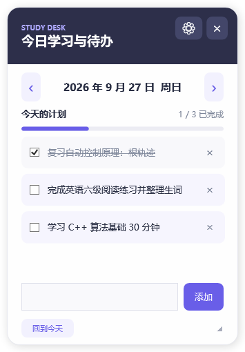

# StudyDesk

StudyDesk is a small Windows desktop widget for daily study plans and to-dos. It shows the selected day's tasks, tracks completion, and keeps previous days available for review.

## Download and run

Download [StudyDesk.exe](StudyDesk.exe) and run it on Windows. The app uses the built-in .NET Framework 4.x desktop runtime and does not require Python or an Electron installation.

On first launch, StudyDesk registers itself to start when you sign in to Windows. Keep the executable in a stable location so the startup path remains valid. You can turn automatic startup off in the widget settings.

## Use

- Enter a task and press Enter or click **添加**.
- Tick a task to mark it complete, or use **×** to delete it.
- Use the arrows beside the date to view and edit other days.
- Drag the header to move the widget; drag its lower-right corner to resize it.
- Open the gear menu to adjust opacity, always-on-top, and startup settings.
- Close the widget to keep it in the system tray. Double-click the tray icon to reopen it; right-click the icon to exit.

Tasks and window settings are stored locally in `%LOCALAPPDATA%\StudyDesk\tasks.json`. Nothing is synced to a server.

## Build from source

The source is in [`src/StudyDesk.cs`](src/StudyDesk.cs). On Windows with the .NET Framework compiler available, run [`src/build.ps1`](src/build.ps1) in PowerShell. The script writes `StudyDesk.exe` at the repository root.

